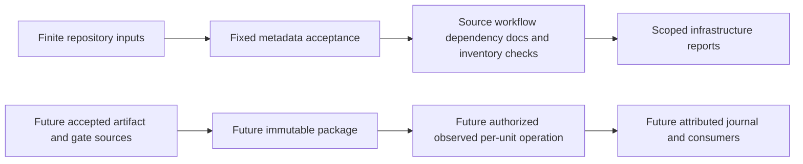

<!--
SPDX-License-Identifier: AGPL-3.0-or-later
Commercial license available
© Concepts 1996–2026 Miroslav Šotek. All rights reserved.
© Code 2020–2026 Miroslav Šotek. All rights reserved.
ORCID: 0009-0009-3560-0851
Contact: www.anulum.li | protoscience@anulum.li
DEPLOY-PACK — repository governance and provenance
-->

# Architecture

The implemented surface is local repository validation tooling under tools/deploy_validation. Fixed scripts validate metadata, source provenance, workflow policy, exact development dependencies, rendered documentation and deterministic inventory. Structured diagnostics describe the named infrastructure operation. Input cannot choose executable code or a weaker policy.

An independently pinned closed metadata schema binds repository identity, governance profile, interpreter and raw development lock. Metadata acceptance precedes exclusive output generation. Read-only verification does not repair an inventory or grant domain admission.

The planned deployment library composes existing bitstream, driver, performance and provenance artifacts with prior policy and required source-owned gate verdicts. Its immutable package precedes later installation observations, recorder segments and field feedback. Per-unit operations require actual authorized target adapters; a host return code does not establish an observed target state.

Common sealing and trust belong to EVIDENCE-MANIFEST-TOOLKIT. Evidence suppliers retain measurement and verdict ownership; Field Ops owns health judgment, and Ledger retains lineage. DEPLOY-PACK is not a signing authority or fleet-management server. These remain planned integrations rather than installed dependencies.

Read the [component guide](docs/ARCHITECTURE.md), [trust boundaries](docs/THREAT_MODEL.md) and [validation commands](VALIDATION.md).
